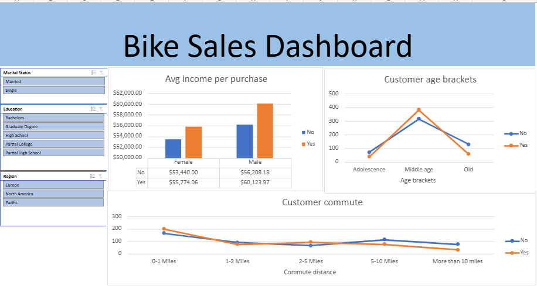

# Bike Sales Performance & Customer Demographics Dashboard

## 📌 Project Overview
An end-to-end data analytics project using Excel to clean customer demographic data, uncover purchasing patterns, and build an interactive sales dashboard.

## 📸 Dashboard Preview

## 🛠️ Data Cleaning & Logic
- Standardized gender entries (`M`/`F` to `Male`/`Female`).
- Built nested conditional logic (`IF`/`IFS`) to create age brackets (`Adolescence`, `Middle Age`, `Old`).
- Removed duplicates and trimmed string whitespaces for data integrity.

## 📊 Key Findings
- **Income Influence:** Higher average income correlates with bike purchases, particularly among male buyers.
- **Target Age:** Middle-aged customers (31–54) represent the largest segment of bike buyers.
- **Commute Distance:** Customers commuting under 1 mile show the highest conversion rate.

## ⚙️ Tools Used
- Microsoft Excel / Google Sheets (Pivot Tables, Pivot Charts, Slicers, Text & Logical Functions)

---

## 📚 Credits & Acknowledgments
- **Dataset & Tutorial:** [Alex The Analyst - Excel Portfolio Project](https://www.youtube.com/watch?v=opJgMj1IUqo)
- **Analysis & Dashboard Implementation:** Built independently using Excel / Google Sheets logic, custom styling, and layout optimizations.