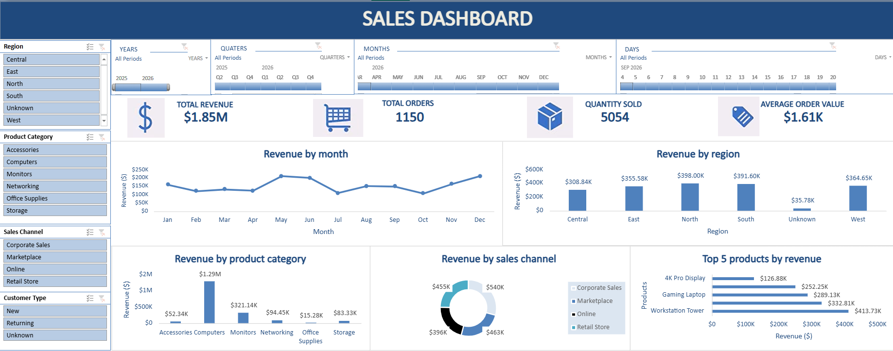

# Interactive Sales Performance Dashboard | Excel Online

An end-to-end sales analytics project developed entirely using **Microsoft Excel Online**. The project demonstrates data cleaning, data preparation, PivotTable analysis, KPI development, and interactive dashboard creation to explore sales performance across multiple business dimensions.

## Dashboard Preview

## Project Objective

The objective of this project is to analyse sales performance across regions, product categories, sales channels, and customer segments. The interactive dashboard provides a consolidated view of key performance indicators (KPIs), revenue trends, and product performance to support data-driven business decisions.

## Dataset

The dataset was generated using **Google Gemini** specifically for this project. It was intentionally designed with realistic data-quality issues to simulate an unprocessed business dataset and provide practical experience in data cleaning and preparation.

The dataset contained several inconsistencies, including:

- Missing values and duplicate records.
- Inconsistent text formatting and capitalization.
- Date format inconsistencies.
- Pricing anomalies and data type mismatches.
- Inconsistent category, region, and customer labels.

## Data Cleaning and Preparation

The raw dataset was inspected, cleaned, and transformed before analysis.

Key activities included:

- **Data Quality Checks:** Identified missing values, duplicate records, inconsistent entries, and potential pricing anomalies.
- **Text Standardization:** Removed unnecessary spaces and corrected inconsistent capitalization using `TRIM()` and `PROPER()`.
- **Date Standardization:** Addressed inconsistent date formats and prepared date fields for time-based analysis.
- **Data Transformation:** Created helper columns for Year, Quarter, Month, and Day to support temporal analysis and interactive filtering.
- **PivotTable Preparation:** Organized the cleaned data and addressed PivotTable cache inconsistencies to ensure accurate filtering and reporting.

## Dashboard Features

The dashboard includes four key performance indicators:

| KPI | Value |
|---|---:|
| Total Revenue | $1.85M |
| Total Orders | 1,150 |
| Quantity Sold | 5,054 |
| Average Order Value | $1.61K |

### Visualizations

| Visualization | Chart Type | Purpose |
|---|---|---|
| Revenue by Month | Line Chart | Analyse monthly revenue trends |
| Revenue by Region | Column Chart | Compare regional sales performance |
| Revenue by Product Category | Column Chart | Evaluate category-wise revenue |
| Revenue by Sales Channel | Doughnut Chart | Understand sales channel contribution |
| Top 5 Products by Revenue | Horizontal Bar Chart | Identify highest-revenue products |

### Interactive Filters

The dashboard includes interactive slicers and time-based filters for:

- Region
- Product Category
- Sales Channel
- Customer Type
- Year
- Quarter
- Month
- Day

These filters allow users to explore sales performance across different business segments and time periods.

## Key Business Insights

Based on the dashboard analysis:

1. **Product Category:** Computers generated the highest revenue, contributing approximately $1.29M.
2. **Regional Performance:** The North region recorded the highest revenue at approximately $398K.
3. **Product Performance:** Workstation Tower was the highest-revenue product, generating approximately $413.73K.
4. **Data Quality Observation:** The Unknown region contributed approximately $35.78K, highlighting an opportunity for further investigation into missing or unclassified regional information.

## Tools and Techniques

- **Microsoft Excel Online:** Data preparation, analysis, and dashboard development.
- **Excel Formulas:** Data cleaning, text standardization, and calculations.
- **PivotTables:** Data aggregation and multidimensional analysis.
- **PivotCharts:** Visual representation of sales performance.
- **Interactive Slicers:** Dynamic filtering and dashboard exploration.
- **Data Visualization:** KPI cards, charts, and dashboard layout design.

## Key Learnings

Through this project, I gained practical experience in:

- Identifying and resolving data-quality issues.
- Preparing raw datasets for analysis.
- Working with Excel formulas and data transformation techniques.
- Building PivotTables and PivotCharts.
- Creating interactive dashboards using slicers.
- Translating sales data into meaningful business insights.

## References and Inspiration

Dashboard layout and data visualization principles were inspired by **Marg Analytics**.

## Author

**Nazreen Shanavaz**

[GitHub Profile](https://github.com/NazreenShanavaz)
